# JAGUAR LAB

**Sua produção no controle.** Gestão de impressão 3D para celular Android, tablet e computador Windows, com dados no aparelho e backup privado individual.

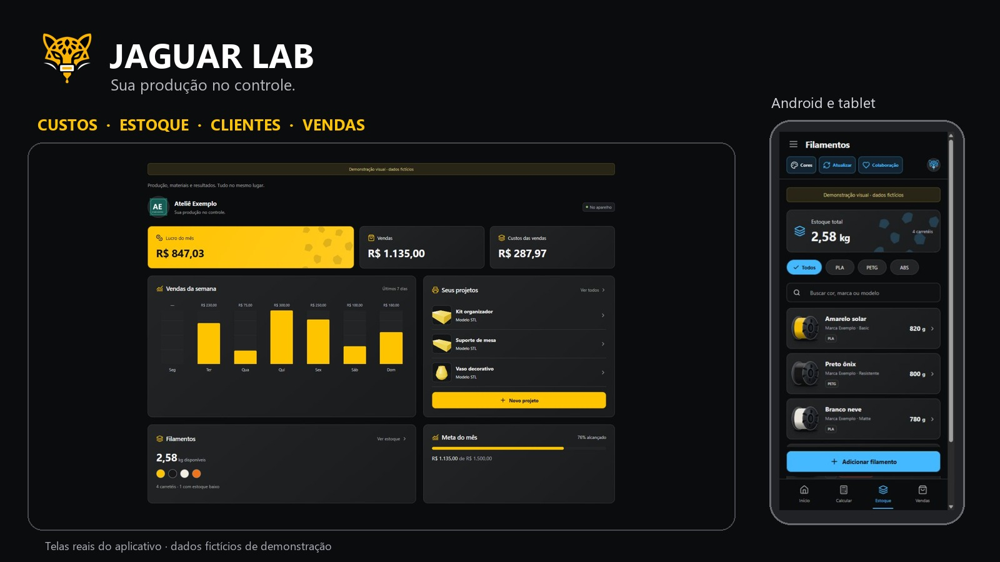

Grupo da comunidade: novidades, dúvidas e sugestões. Participação opcional. Não compartilhe tokens, senhas ou backups no grupo.

[**BAIXAR A ÚLTIMA VERSÃO DO JAGUAR LAB**](https://github.com/PeraTV/jaguarlab/releases/latest)

## Baixar e começar

| Plataforma | Download oficial |
| --- | --- |
| Android — celular e tablet | [Baixar JaguarLab 0.5.6 — APK](https://github.com/PeraTV/jaguarlab/releases/download/v0.5.6/JaguarLab-0.5.6-Android.apk) |
| Windows 64 bits | [Baixar JaguarLab 0.5.6 — instalador](https://github.com/PeraTV/jaguarlab/releases/download/v0.5.6/JaguarLab-0.5.6-Setup.exe) |
| macOS — Intel | [Baixar DMG Intel](https://github.com/PeraTV/jaguarlab/releases/download/v0.5.6/JaguarLab-0.5.6-macOS-x64.dmg) |
| macOS — Apple Silicon | [Baixar DMG Apple Silicon](https://github.com/PeraTV/jaguarlab/releases/download/v0.5.6/JaguarLab-0.5.6-macOS-arm64.dmg) |
| Linux — Debian/Ubuntu/Mint 64 bits | [Baixar DEB](https://github.com/PeraTV/jaguarlab/releases/download/v0.5.6/JaguarLab-0.5.6-Linux-x64.deb) |
| Linux — AppImage 64 bits | [Baixar AppImage](https://github.com/PeraTV/jaguarlab/releases/download/v0.5.6/JaguarLab-0.5.6-Linux-x64.AppImage) |
| Todas as versões | [Releases e arquivos de verificação](https://github.com/PeraTV/jaguarlab/releases) |

Ao atualizar, instale por cima da versão anterior, sem desinstalar. Exporte um backup antes. O Android requer versão 7 ou superior; a capacidade de abrir modelos grandes depende da memória do aparelho.

**Não precisa criar uma conta no JAGUAR LAB, contratar hospedagem ou informar token para usar o app e baixar atualizações.** O GitHub privado é uma opção de backup de cada pessoa.

## Conheça o aplicativo em vídeo

[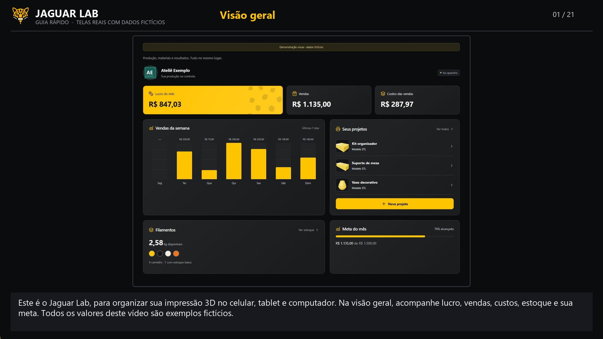](https://raw.githubusercontent.com/PeraTV/jaguarlab/v0.5.6/guides/tutorial-completo.mp4)

- [Guia completo — 3min53s, 21 capítulos](https://raw.githubusercontent.com/PeraTV/jaguarlab/v0.5.6/guides/tutorial-completo.mp4): telas reais do app, exemplos fictícios, voz neural em português e legendas.
- [Backup, repositório privado e token — passo a passo atualizado](https://raw.githubusercontent.com/PeraTV/jaguarlab/v0.5.6/guides/tutorial-backup.mp4): telas demonstrativas com identidade JAGUAR LAB, sem contas ou credenciais reais.
- [Índice dos capítulos e transcrição](docs/TUTORIAIS.md). No app, abra **Tutoriais** e toque no capítulo desejado.

## O que você pode fazer

| Área | Como ajuda no seu trabalho |
| --- | --- |
| Visão geral | Lucro do mês, vendas, custos, gráfico semanal, projetos recentes, estoque e meta mensal. |
| Calculadora | Custos de filamento, energia, máquina, trabalho, extras e taxas, com ou sem modelo 3D ou carretel cadastrado. |
| Quanto cobrar | Margem ou acréscimo sobre o custo, atalho de 100% e sugestão editável conforme o tipo de peça e trabalho adicional. |
| Orçamentos | Salvar sem baixar estoque; personalizar prazo, pagamento, validade e observações; copiar, compartilhar ou abrir no WhatsApp para revisar. |
| Projetos | Nome, foto, observações, STL/3MF, prévia compatível e perfil de estimativa vinculado à peça. |
| Filamentos | Carretéis separados por marca, linha, material e cor; peso inicial, preço, consumo, saldo e alerta de estoque baixo. |
| Produção | Registrar peças concluídas e falhas com consumo; corrigir lançamentos por estorno, preservando o histórico. |
| Vendas | Vender lotes ou quantidades parciais, vincular cliente, controlar pagamentos e cancelamentos. |
| Clientes | Nome, telefone, e-mail, CPF e observações opcionais; histórico e totais das vendas vinculadas. |
| Impressoras | Referências iniciais editáveis e cadastro personalizado de bico, volume, camada, consumo médio e custo por hora. |
| Minha empresa | Foto própria, nome, contatos e cadastro adicional opcional, incluindo razão social, CNPJ e endereço. |
| Relatórios | Período, faturamento, lucro, despesas e rankings de produtos, dias, meses e gastos por marca e cor. |
| Energia | Estado e cidade, referência da ANEEL, Light e outras distribuidoras; ajuste manual pela conta de luz. |
| Personalizar cores | Fundo e destaque independentes; opção para o desenho do jaguar acompanhar o tema. |
| Backup | Exportação protegida, envio e importação de cópias do GitHub privado; acesso salvo opcional no aparelho. |
| Atualizações | Consulta pública, download e verificação do instalador; confirmação final pelo sistema. |
| Colaboração | Apoio voluntário ao projeto, sem bloquear recursos. |

## Veja algumas telas

Capturas com dados fictícios de demonstração. Clique nas imagens para ampliar. A aparência se adapta ao tamanho da tela e às cores escolhidas.

| Visão geral | Estoque de filamentos |
| --- | --- |
| 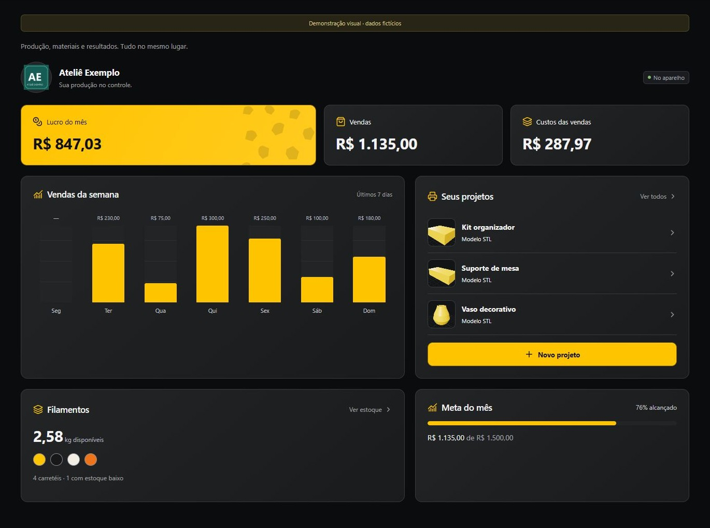 | 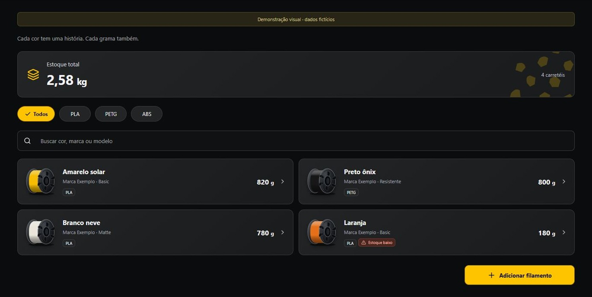 |

| Calculadora | Relatórios |
| --- | --- |
| 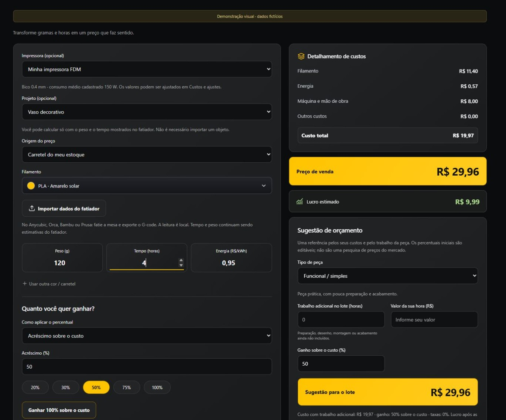 | 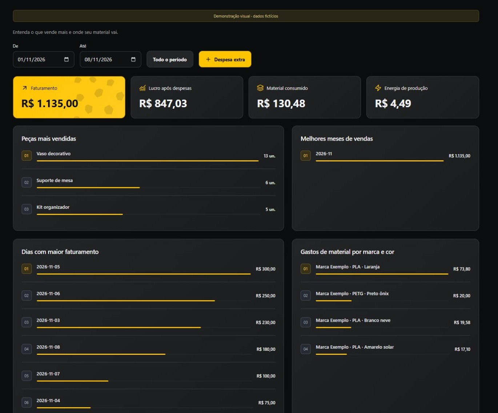 |

| Prévia de um projeto | Orçamento para compartilhar |
| --- | --- |
| 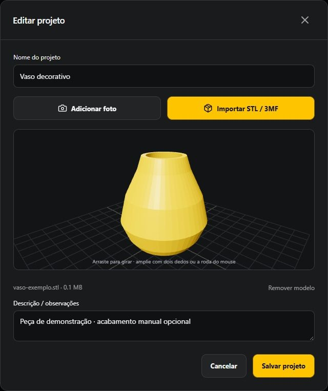 | 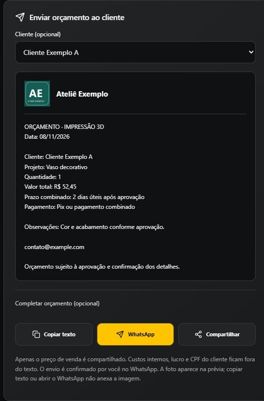 |

| Clientes | Impressoras |
| --- | --- |
| 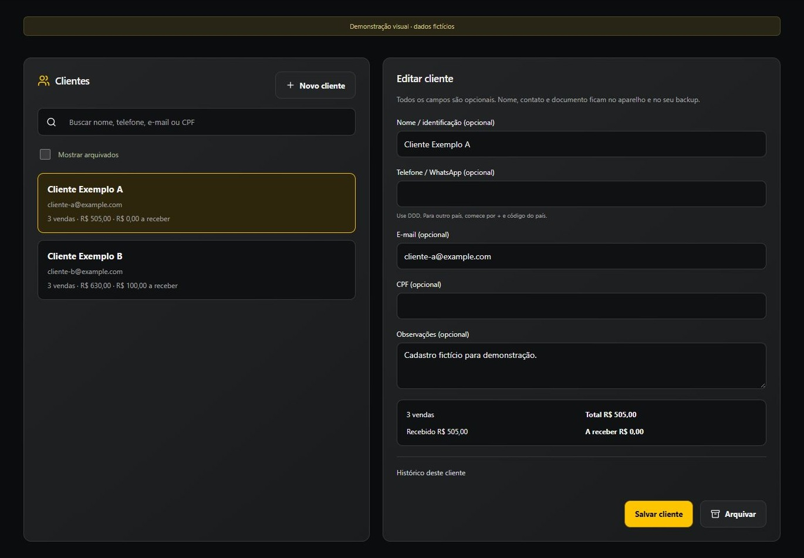 | 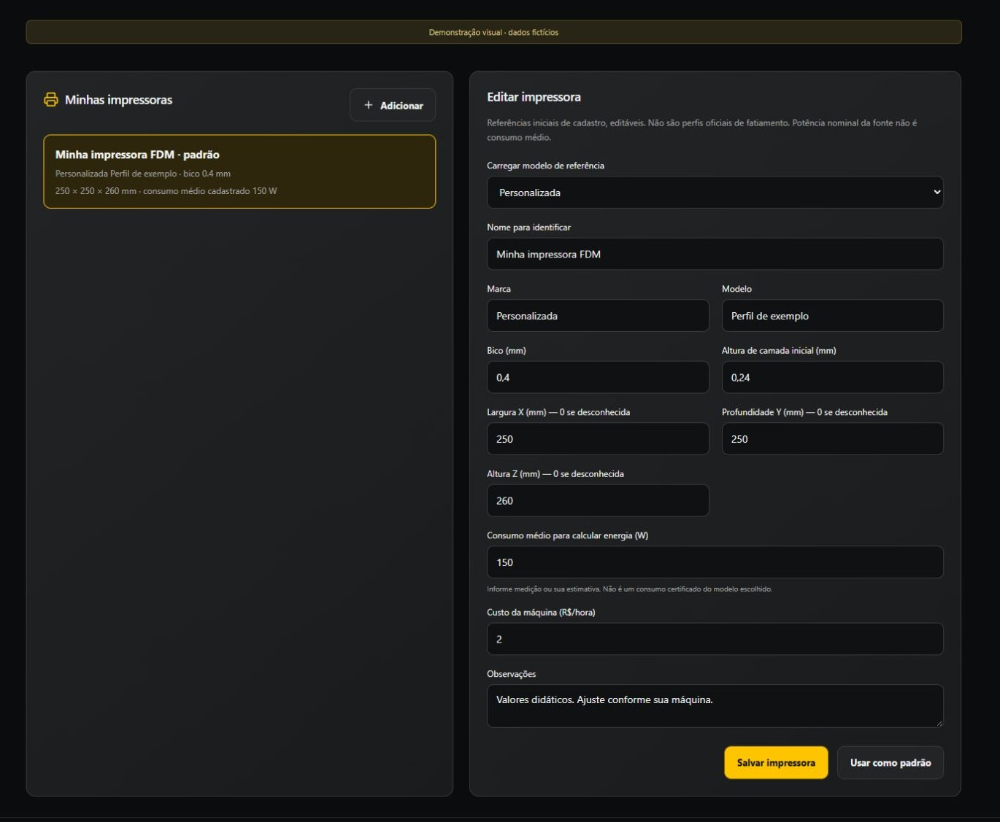 |

| Interface em tamanho de celular | Vendas no celular |
| --- | --- |
| 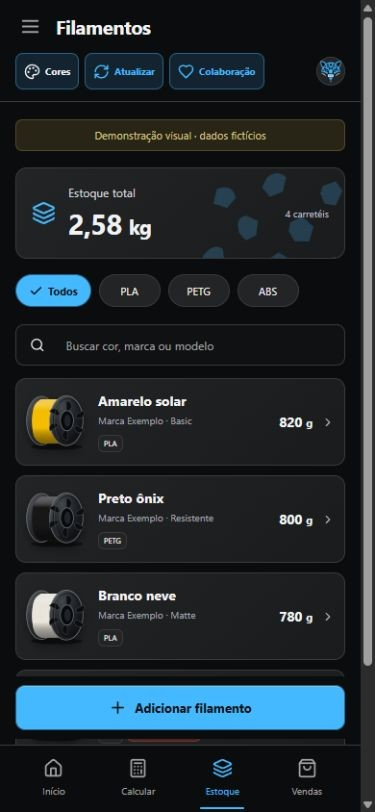 | 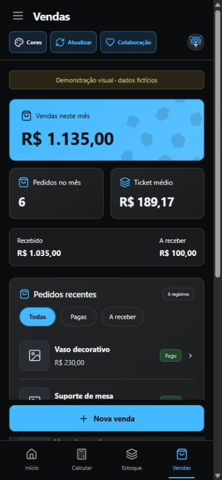 |

## Um fluxo simples

1. Cadastre os carretéis e revise o consumo médio e o custo da impressora.
2. Cadastre a peça, se desejar; o cálculo também funciona sem projeto e sem arquivo.
3. Informe peso e tempo do fatiador. Confira suportes, purga, perdas e os demais custos.
4. Escolha o ganho desejado, revise o orçamento e envie ao cliente.
5. Depois da impressão, registre o consumo nos carretéis corretos. Salvar orçamento não altera o estoque.
6. Registre a venda e o recebimento. A venda não desconta novamente o filamento.
7. Exporte um backup e guarde também seus modelos 3D originais.

## Seus dados ficam com você

Não existe servidor próprio do projeto nem conta central de clientes. Cadastros, cálculos e relatórios funcionam no aparelho. Consultas de cidades, tarifas, vídeos, atualizações e backup online usam internet.

O backup online é opcional: cada pessoa cria **seu repositório privado e seu token**. O aplicativo recusa o canal público de distribuição como destino de backup. Os dados de clientes, empresa, estoque e vendas não são enviados ao repositório do criador.

| Informação | No backup exportado/privado? |
| --- | --- |
| Cadastros, vendas, produções, custos e configurações | Sim |
| Foto da empresa e fotos adicionadas aos projetos | Sim |
| STL/3MF e prévias geradas dos modelos | Não; permanecem no aparelho |
| Token do GitHub | Não; sessão ou acesso protegido neste aparelho, se você escolher |

Guarde a senha do backup. Não há recuperação dessa senha. Restaurar substitui os registros locais; não mescla bases nem sincroniza aparelhos automaticamente. [Detalhes de privacidade e armazenamento](docs/PRIVACIDADE.md).

## Limites que você precisa conhecer

- **Não é um fatiador nem um controlador de impressora.** Use o fatiador para preparar trajetórias e conferir tempo, peso, escala e suportes.
- Arquivos STL/3MF de até **1 GiB**, apresentado como 1 GB no app, sujeitos à memória e à complexidade. STL binário grande usa prévia simplificada. 3MF grande depende da imagem incluída para mostrar a prévia; extensões proprietárias podem não ser compatíveis.
- G-code de texto de até **20 MB**, com leitura dos totais disponíveis e trajetórias compatíveis. Arquivos binários ou sem estatísticas podem exigir preenchimento manual.
- Estimativas geométricas são aproximadas. O app não calcula um fatiamento completo; nem a estimativa do próprio fatiador garante o tempo físico exato.
- Referência ANEEL residencial convencional B1 sem impostos e bandeira: confira a distribuidora e o valor final por kWh na sua conta.
- Sugestões de preço usam os custos informados e percentuais editáveis; não são uma pesquisa do mercado local.
- Um arquivo físico de 1 GB ainda não foi validado em celular. Há teste de importação com STL real de 72 MB.

## Ajuda e informações completas

- [Manual de todas as funções](docs/GUIA.md)
- [Instalação e atualização](docs/INSTALACAO.md)
- [Backup, token e privacidade](docs/PRIVACIDADE.md)
- [Vídeos, capítulos e transcrições](docs/TUTORIAIS.md)
- [Perguntas frequentes e solução de problemas](docs/SUPORTE.md)
- [Código e instruções de desenvolvimento](app/README.md)
- [Relatar um problema](https://github.com/PeraTV/jaguarlab/issues/new)

Este repositório se chamava `onca3d-atualizacoes`. O endereço oficial agora é **PeraTV/jaguarlab**; links antigos são preservados para compatibilidade. Não envie tokens, senhas, documentos de clientes ou backups pessoais em issues, fotos ou comentários públicos.

## Versão 0.5.6

Corrige o instalador temporário ocupado no Windows, adota nomes **JaguarLab** nos downloads principais, atualiza o canal após a mudança de nome do repositório e amplia os tutoriais com vídeos e capítulos. Mantém a assinatura Android e as identidades internas para preservar instalações e registros existentes.

Prévia para avaliação. A confirmação de instalação continua sendo feita pelo sistema. Apoiar o projeto em **Colaboração** é opcional.

## Backup entre aparelhos e acesso salvo

Sem Manter conectado, o token fica somente na sessão. Se você marcar Manter conectado neste aparelho e tocar em Salvar acesso, repositório, token e senha do backup ficam cifrados com a proteção local do sistema: Android Keystore no Android e safeStorage/DPAPI no Windows. Não entram nos backups. Desconectar remove esse acesso salvo. No navegador, não há persistência de credenciais. A opção não renova tokens vencidos ou revogados.

No celular, Enviar backup. No PC ou tablet, Buscar backups, escolher a cópia e Importar do GitHub. Use o mesmo repositório e senha. A importação substitui a base do destino após confirmação e cópia de segurança; não há sincronização automática. Veja o [tutorial completo](docs/TUTORIAIS.md).

## macOS e Linux (0.5.6)

- Mac Intel: **macOS-x64.dmg**. Mac com chip Apple M1 ou posterior: **macOS-arm64.dmg**. Abra o DMG e arraste JAGUAR LAB para Aplicativos. Para atualizar, feche o app e substitua a cópia anterior. Os dados ficam fora do aplicativo.
- O pacote Mac usa assinatura ad hoc, sem certificado Developer ID nem notarização da Apple. O macOS pode bloquear a primeira abertura e exigir sua autorização nas opções de segurança do sistema. Não é uma versão da App Store. Não desative as proteções globais do sistema.
- Linux 64 bits (x86_64): **DEB** para Debian/Ubuntu/Mint ou **AppImage** para outras distribuições compatíveis. No AppImage, habilite a permissão de execução nas propriedades do arquivo. O DEB abre no gerenciador de pacotes e pode pedir a senha de administrador para instalar. Não execute o app como root.
- O botão Atualizar baixa e confere o instalador correto. No Mac, confirme a substituição em Aplicativos. No Linux, conclua pelo gerenciador de pacotes e reabra. Quem usa AppImage pode baixar a nova AppImage na página de versões e substituir a anterior.
- Manter conectado usa o Keychain do macOS ou um chaveiro seguro do Linux (libsecret/KWallet). Se o Linux não oferecer chaveiro protegido, a opção fica indisponível e o acesso funciona somente na sessão; o app não grava o token em texto simples.
- Dados permanecem locais, sem servidor próprio. Para transferir Android/Windows/Mac/Linux, envie e importe o backup com a mesma senha; a importação substitui o destino e não mescla bases. Os modelos 3D originais devem ser transferidos separadamente.
- Os instaladores são compilados no GitHub Actions em máquinas dos respectivos sistemas. Ainda não foram validados em um Mac/Linux físico do usuário. Arquiteturas Linux ARM não são incluídas nesta prévia.

Referências: [Electron safeStorage](https://github.com/electron/electron/blob/main/docs/api/safe-storage.md), [formatos de instalação](https://www.electron.build/v26/docs/targets/).
