# Manual do JAGUAR LAB

[Página principal](../README.md) · [Vídeos](TUTORIAIS.md) · [Backup e privacidade](PRIVACIDADE.md)

As capturas abaixo usam dados fictícios. Os campos e posições podem variar pelo tamanho da tela. No celular, use os quatro atalhos inferiores e o menu lateral para as outras áreas.

## Visão geral

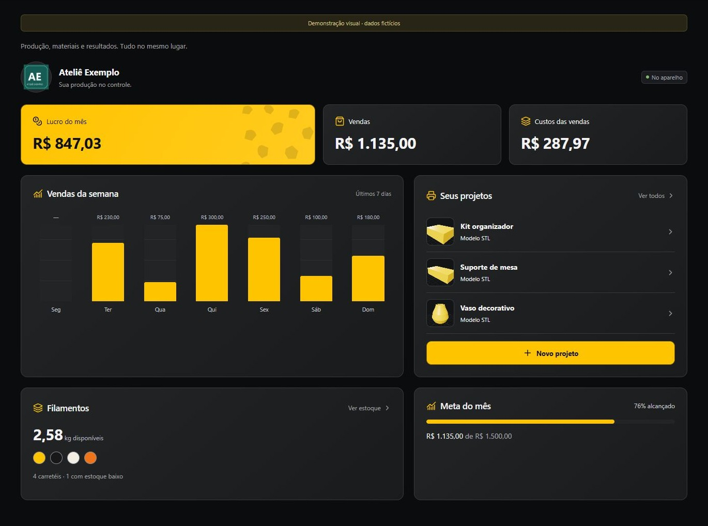

O painel reúne vendas, custos, lucro do mês, gráfico dos últimos sete dias, projetos recentes, saldo de filamentos e meta mensal. Não são valores previstos: dependem dos registros feitos no aparelho. A meta pode ser alterada em Configurações. O nome e a foto junto ao ateliê são personalizáveis em Minha empresa.

## Minha empresa

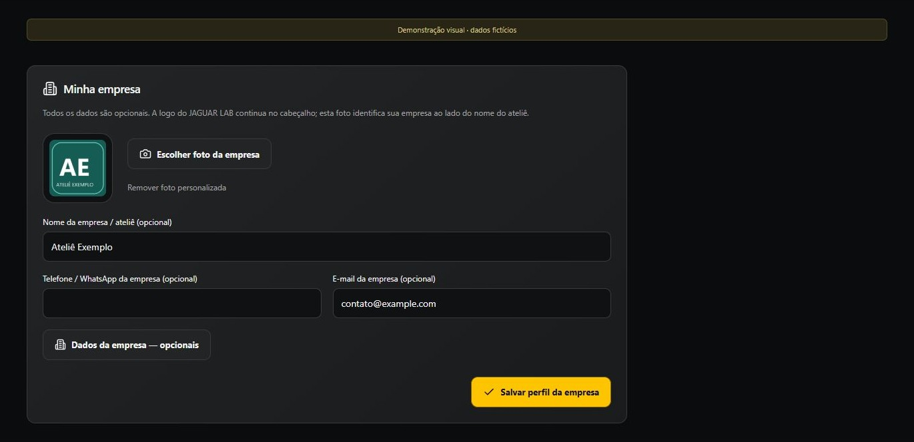

Escolha uma foto JPG, PNG ou WebP, informe o nome e os contatos que desejar e salve. PNG preserva transparência. Em **Dados da empresa — opcionais**, podem ser informados razão social, CNPJ, inscrição, endereço, cidade, UF, CEP, site e observações. Nenhum dado fiscal ou contato é obrigatório. Esses dados não são enviados automaticamente a um cliente: os dados fiscais só entram no orçamento se a opção de inclusão estiver marcada.

## Clientes

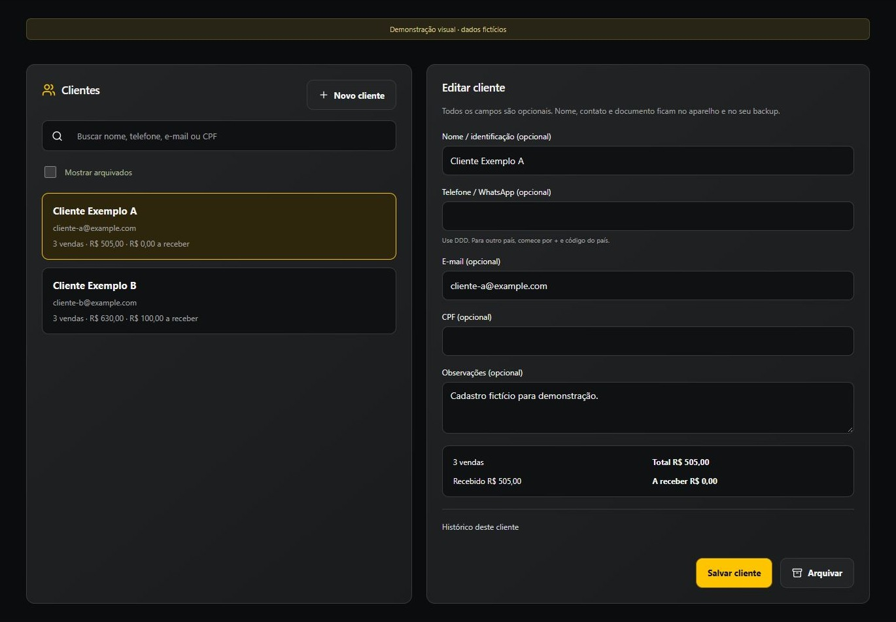

Clique em Novo cliente, preencha o que desejar e salve. Nome, telefone, e-mail, CPF e observações são independentes e opcionais. Para associar uma venda, selecione o cliente cadastrado em Nova venda. Os totais usam esse vínculo por cadastro, não apenas o texto do nome. Editar ou arquivar um cliente preserva o histórico. Arquivados podem ser mostrados e reativados. CPF e observações privadas não entram na mensagem de orçamento.

## Impressoras

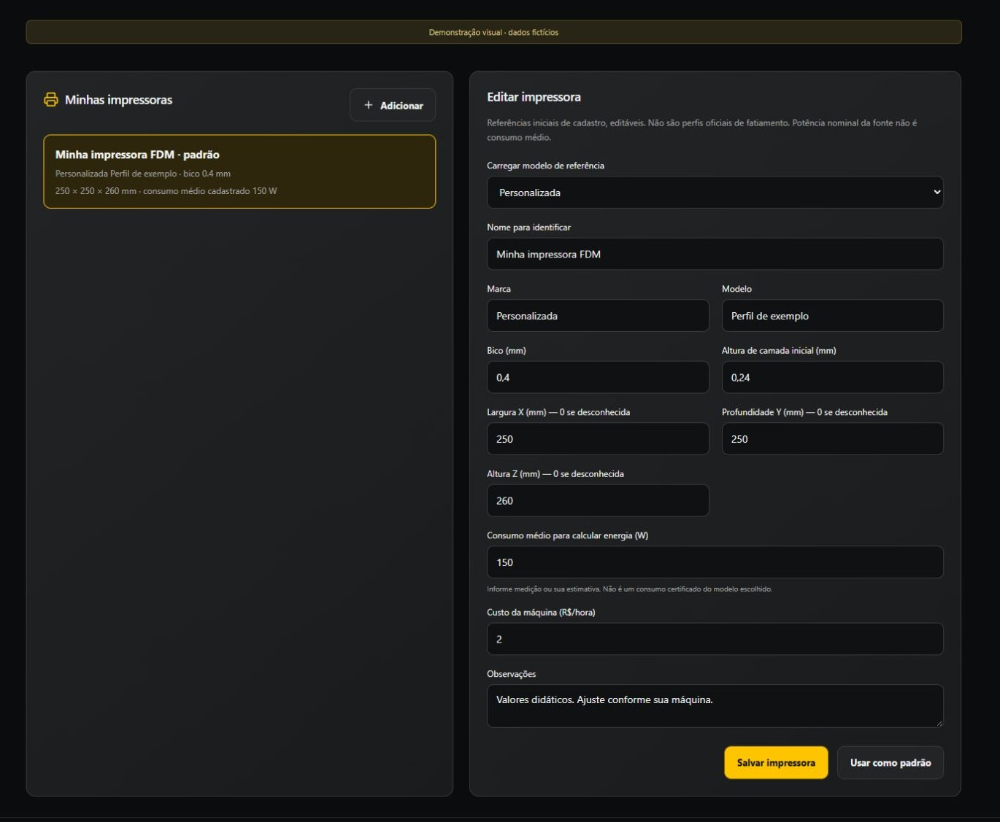

Escolha uma referência de cadastro ou Personalizada. Confira bico, volume X/Y/Z e camada inicial. Informe o consumo médio em watts e o custo por hora da máquina, conforme sua operação. A potência máxima da fonte não equivale ao consumo médio. O catálogo é inicial e editável; não são perfis oficiais completos de fatiamento. Selecionar uma impressora na calculadora aplica esses valores e sugere bico/camada na estimativa. Confira dimensões e orientação no fatiador.

## Projetos, fotos e modelos

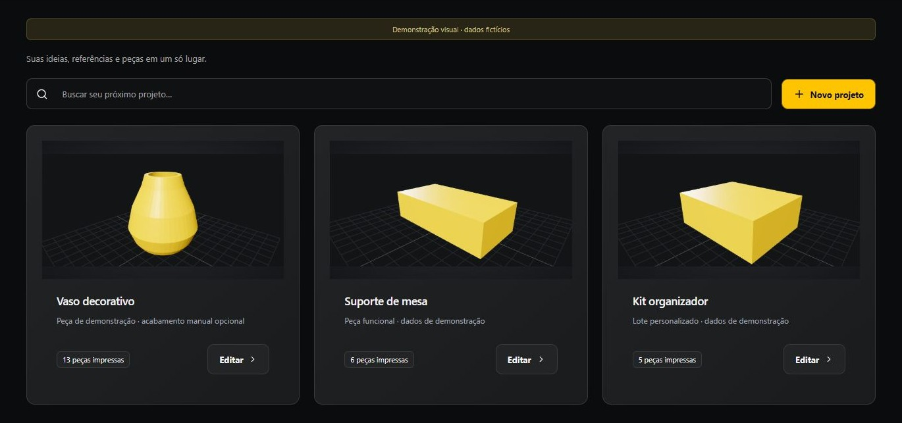

Em Novo projeto, informe um nome e adicione foto e/ou STL/3MF, se quiser. Observações são opcionais. A prévia permite giro e zoom nos modelos compatíveis; no celular, use os dedos. Um modelo grande pode usar uma versão simplificada ou uma imagem do 3MF. Veja os limites na [página principal](../README.md#limites-que-você-precisa-conhecer).

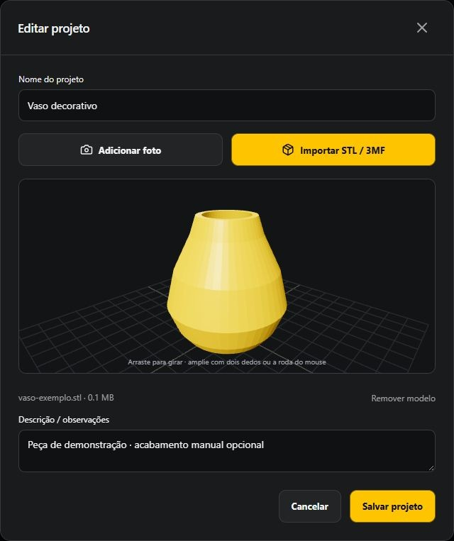

O original não é enviado ao GitHub. Mantenha-o em sua pasta de arquivos. Após restaurar o backup em outro aparelho, abra **Projetos → Editar → Importar STL / 3MF** e selecione novamente o original. Fotos adicionadas pelo usuário são diferentes da miniatura gerada automaticamente pelo modelo.

## Filamentos e controle de saldo

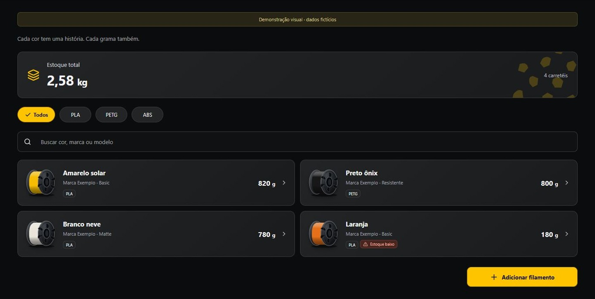

Cadastre cada rolo separadamente: nome da cor, marca, linha/modelo, material, cor real, peso inicial e preço correspondente. Abra o carretel para conferir peso inicial, consumo, saldo e custo por grama. Configure o limite de alerta nas configurações.

Para um rolo já aberto, pese o material restante descontando a tara do carretel vazio. Informe esse saldo como peso inicial e o custo proporcional do material restante. Exemplo: um rolo de 1 kg custou R$ 100; restam 600 g; cadastre 600 g e R$ 60. Assim, o custo segue R$ 0,10/g. Não cadastre 600 g pelo preço integral se quiser manter esse custo unitário.

**O saldo diminui quando você registra uma impressão**, com o peso informado para cada cor. Não diminui só por visualizar um arquivo, fazer um orçamento ou cadastrar uma venda. Inclua suportes, purga e desperdício no consumo. Um novo rolo com outro preço deve ser outro cadastro; rolos com consumo preservam seu custo histórico.

## Calculadora

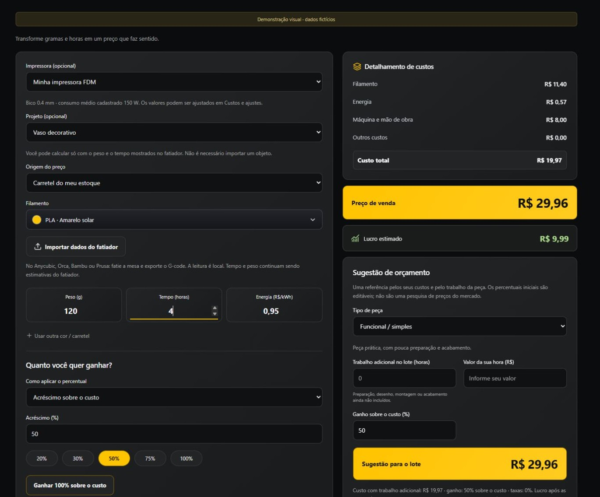

Escolha um carretel ou **Informar preço por kg**. Informe peso e tempo do lote, consumo médio em W e tarifa em R$/kWh. O projeto e o arquivo são opcionais. Você pode calcular usando apenas o que vê no fatiador. Para registrar baixa do estoque, é necessário escolher um projeto e um carretel cadastrado.

Em **Custos e ajustes**, inclua máquina por hora, mão de obra, embalagem/extras, taxas, quantidade de peças e resultado da impressão. Os pesos e o tempo referem-se ao lote completo; a quantidade permite calcular o valor unitário.

| Cálculo | Fórmula |
| --- | --- |
| Filamento do carretel | gramas usadas × preço do rolo ÷ peso inicial do rolo |
| Material com preço por kg | gramas × preço/kg ÷ 1.000 |
| Energia | horas × watts ÷ 1.000 × tarifa/kWh |
| Máquina | horas × custo da máquina por hora |
| Custo total | material + energia + máquina + mão de obra + extras |
| Preço com acréscimo | custo × (1 + percentual/100) ÷ (1 − taxas/100) |
| Preço com margem | custo ÷ (1 − (margem + taxas)/100) |
| Lucro estimado | preço após taxas − custo total |

**100% de acréscimo sobre o custo** dobra o custo antes das taxas. **100% de margem sobre a venda** não gera um preço finito válido. Com margem, a soma de margem e taxas precisa ser menor que 100%.

## Sugestão de quanto cobrar

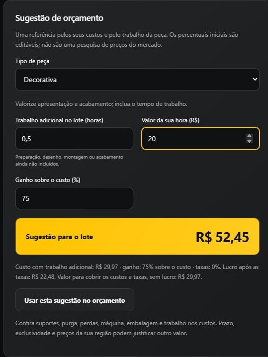

Escolha Funcional, Decorativa ou Personalizada. Os percentuais iniciais são referências editáveis, não pesquisa de mercado. Informe horas de trabalho adicional e o valor da sua hora para preparação, desenho, acabamento e montagem que ainda não estejam nos custos. O painel mostra custo, sugestão para o lote, preço por peça, lucro após taxas e valor para cobrir custos sem lucro.

**Usar esta sugestão no orçamento** aplica mão de obra e acréscimo ao cálculo e zera os campos de trabalho adicional para evitar contar a mesma inclusão novamente. Confira concorrência, complexidade, qualidade, prazo e demanda da sua região antes de combinar o preço.

## Dados do fatiador e estimativa geométrica

Exporte um G-code de texto de até 20 MB após fatiar e use **Importar dados do fatiador**. O app lê o tempo e as gramas presentes no arquivo e mostra trajetórias compatíveis por camadas. Quando um total não existe no arquivo, digite o valor mostrado pelo fatiador. Em arquivos com várias cores, confira a distribuição de cada peso nos carretéis corretos.

Um 3MF fatiado pode trazer dados por mesa: escolha a mesa certa. Um STL não contém um fatiamento. A estimativa geométrica opcional usa camada, material/densidade, paredes, preenchimento, velocidade média, largura de linha e limite de fluxo. Ela não reproduz todas as trajetórias, acelerações, suportes ou resfriamento. Malhas abertas ou prévias simplificadas podem não oferecer essa aproximação.

A calibração é vinculada à mesma peça e às mesmas opções. Use valores do seu fatiador como referência e salve o perfil. Alterar perfil, geometria ou impressora pode desativar uma calibração anterior. O app não imprime nem envia o modelo à impressora.

## Orçamento para o cliente

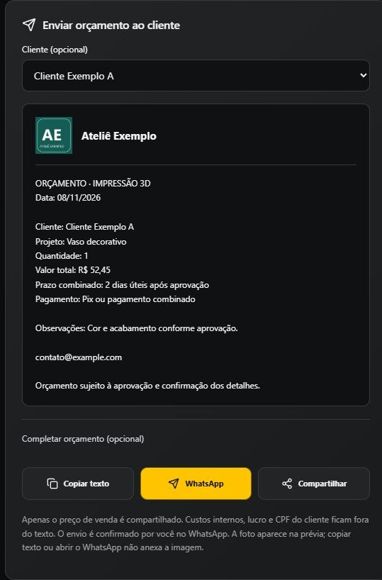

Selecione um cliente opcional e complete nome da peça, prazo combinado, condição de pagamento, validade e observações. Prazo de entrega é diferente do tempo de impressão. Revise a prévia e escolha Copiar texto, WhatsApp ou Compartilhar. O WhatsApp abre uma mensagem para sua revisão; não há envio automático.

O texto inclui o preço final e os dados comerciais escolhidos, sem custos internos, margem, CPF do cliente ou notas privadas. Dados fiscais da empresa só são incluídos por opção. A logo aparece na prévia, mas os botões de texto não anexam a imagem. **Salvar orçamento não baixa estoque** e funciona também como cálculo rápido sem arquivo.

## Produção, falha e estorno

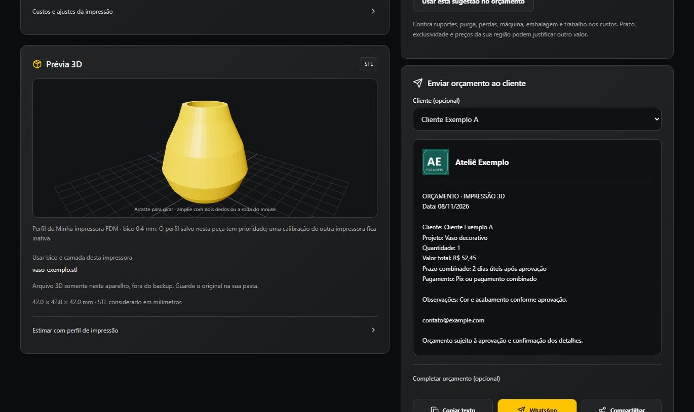

Depois de imprimir, confira o consumo e registre a impressão. Cada registro desconta o peso informado uma vez dos carretéis selecionados. Se a peça falhou e consumiu material, use **Falhou**. Não estorne uma falha real apenas para devolver material que foi gasto.

O estorno serve para corrigir um lançamento: devolve o consumo ao estoque e preserva o registro no histórico. Se houver venda vinculada, cancele a venda primeiro. O app bloqueia saldo negativo e venda acima da quantidade produzida disponível.

## Vendas e pagamentos

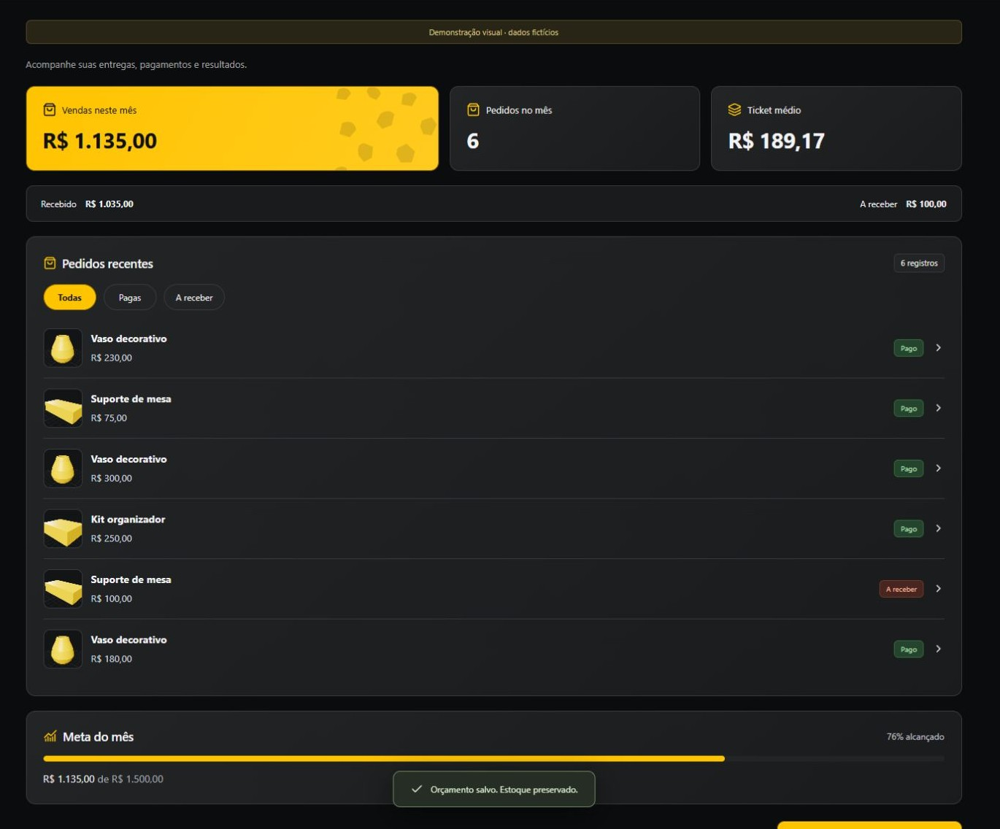

Em Nova venda, selecione uma produção concluída, quantidade, cliente opcional, valor total e taxa da venda. Vendas parciais são permitidas até a quantidade disponível no lote. Marque como pago quando receber e acompanhe Recebido/A receber. Cancelar uma venda não devolve filamento; a peça já foi produzida. Os custos históricos da produção são preservados.

## Relatórios

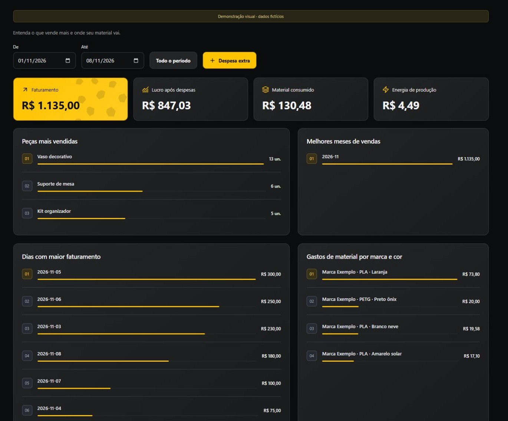

Filtre De/Até ou veja todo o período. Consulte faturamento, lucro após despesas, material e energia consumidos; rankings de peças, dias, meses e marca/cor; e despesas extras. Lucro considera vendas, custo proporcional das peças vendidas, taxas e despesas extras. Produções ainda não vendidas e falhas aparecem no consumo, sem serem abatidas novamente como custo das vendas.

Compras de rolos e consumo de material são informações diferentes. Não cadastre novamente o mesmo material em Despesa extra, nem repita nessa área um custo já incluído na produção.

## Energia e configuração

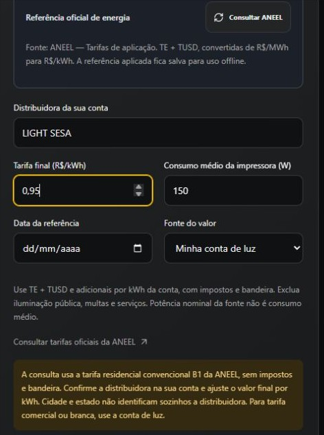

Escolha UF e cidade, consulte a ANEEL e confirme a distribuidora na sua conta; Light consta como Light — Rio de Janeiro (LIGHT SESA). A referência usada é residencial convencional B1, sem impostos e bandeira. Ajuste o valor final por kWh usando os itens de energia da conta, sem iluminação pública, multas e serviços. Para tarifa comercial ou branca, use os valores da sua conta. Cidade/UF não identificam sozinhos a distribuidora nem o custo final. O último valor salvo funciona offline.

Nas configurações também ficam nome do ateliê, meta mensal, limite de alerta de estoque e backup. A empresa possui uma área própria com cadastro completo opcional.

## Cores e logo

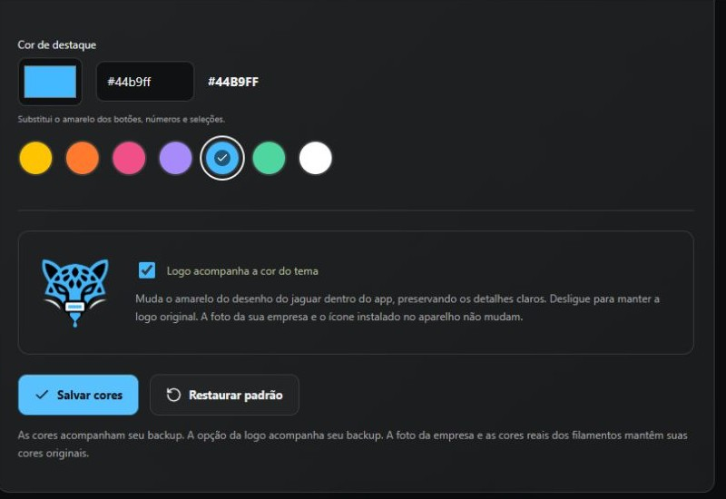

Use paletas, seletor ou código hexadecimal para fundo e destaque. A prévia aparece na hora; toque em Salvar cores para manter. **Logo acompanha a cor do tema** recolore o desenho do jaguar dentro do app, preservando detalhes claros. Desligue para manter a logo original. A foto da empresa, as cores reais dos carretéis e o ícone instalado no aparelho não mudam. Restaurar padrão volta ao preto/amarelo e à logo original.

## Backup, atualizações e colaboração

O [guia de privacidade e backup](PRIVACIDADE.md) explica repositório, token, senha e o que é incluído. A [instalação e atualização](INSTALACAO.md) cobre os instaladores e o erro de arquivo ocupado no Windows. Em Colaboração, a contribuição é voluntária; o app não processa ou confirma pagamentos. Confira o destinatário no banco antes de concluir uma doação.

## Levar os dados do celular para o PC ou tablet

1. No celular com seus dados, abra Configurações → Seu backup, protegido.
2. Informe sua senha de backup, o repositório privado e um token com acesso. Toque em **Enviar backup** e aguarde a confirmação.
3. No PC ou tablet, instale o JAGUAR LAB e abra a mesma área. Use **o mesmo repositório e a mesma senha do backup**. O token pode ser diferente, desde que válido e com acesso ao repositório.
4. Toque em **Buscar backups**, escolha a cópia pela data e toque em **Importar do GitHub**.
5. Confira o resumo, salve a cópia de segurança solicitada e confirme. A importação **substitui** os dados do destino; não mescla duas bases.
6. Guarde os modelos STL/3MF originais e selecione-os novamente nos projetos, pois não são enviados ao GitHub.

Para levar alterações do PC de volta ao celular, envie uma nova cópia pelo PC e importe no celular. Não edite dois aparelhos ao mesmo tempo esperando que os dados sejam combinados: não há sincronização automática.

Sem GitHub: no celular, **Exportar backup**; transfira o arquivo `.onca` pelo meio que preferir; no PC/tablet, **Restaurar arquivo**, usando a mesma senha.

A lista mostra até 100 cópias completas recentes. Cópias anteriores à introdução do histórico podem ter apenas a última versão disponível na lista. Os arquivos antigos não são apagados automaticamente do repositório.

## Manter conectado

Sem Manter conectado, o token fica somente na sessão. Se você marcar Manter conectado neste aparelho e tocar em Salvar acesso, repositório, token e senha do backup ficam cifrados com a proteção local do sistema: Android Keystore no Android e safeStorage/DPAPI no Windows. Não entram nos backups. Desconectar remove esse acesso salvo. No navegador, não há persistência de credenciais. A opção não renova tokens vencidos ou revogados.

## Validade do token

Em Expiration, escolha uma data ou **No expiration**, quando disponível. Com data, substitua o token quando vencer. No expiration significa sem vencimento programado, não acesso garantido para sempre: o token pode ser revogado e o GitHub pode removê-lo após um ano sem uso. Veja [validade e revogação de tokens](https://docs.github.com/en/authentication/keeping-your-account-and-data-secure/token-expiration-and-revocation). Manter conectado não renova o token.
